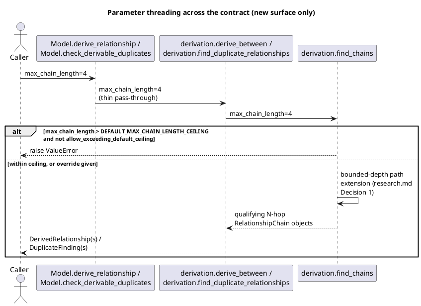

# Contract: Derivation API (library-level, generalized for N-hop chains)

pyArchimate is a library with no CLI or network surface for checker-style capabilities. This feature extends the existing contract established by spec 015-derived-relationships (same methods, same facade convention in `pyArchimate.py`) by adding one new optional parameter to each entry point, plus a new keyword-only override for the default search-depth ceiling.

## `Model.check_derivable_duplicates`

```python
def check_derivable_duplicates(
    self,
    include_dependency: bool = False,
    max_chain_length: int = 2,
    *,
    allow_exceeding_default_ceiling: bool = False,
) -> list["DuplicateFinding"]:
    """
    Scan this model for explicit relationships that duplicate what a
    relationship chain of any length (up to max_chain_length) already
    implies per the ArchiMate 3.2 Specification's derivation rules
    (Appendix B, Section B.2), applied repeatedly along the chain.

    Read-only: never modifies the model.

    :param max_chain_length: longest chain (in relationships) to consider;
        default of 2 reproduces exactly the pre-this-feature behavior
        (FR-010). Values above DEFAULT_MAX_CHAIN_LENGTH_CEILING require
        allow_exceeding_default_ceiling=True (FR-011).
    :param allow_exceeding_default_ceiling: explicit opt-in required to
        raise max_chain_length above the library's documented default
        ceiling, acknowledging the performance tradeoff (FR-011, FR-013).
    :return: one DuplicateFinding per explicit relationship found to be
             a duplicate, each citing the chain(s) of any qualifying
             length that imply it.
    :rtype: list(DuplicateFinding)
    :raises ValueError: if max_chain_length > DEFAULT_MAX_CHAIN_LENGTH_CEILING
        and allow_exceeding_default_ceiling is not True.
    """
```

**Preconditions**: `self` is a loaded `Model` (relationships and elements already populated).
**Postconditions**: `self.rels_dict`, `self.elems_dict`, `self.conns_dict`, and every `View` are unchanged (inherited from spec 015 SC-002). Called with defaults only, the return value is byte-for-byte identical to the pre-this-feature implementation (SC-003, User Story 3 Acceptance Scenario 1).

## `Model.derive_relationship`

```python
def derive_relationship(
    self,
    source: "Element | str",
    target: "Element | str",
    include_dependency: bool = False,
    max_chain_length: int = 2,
    *,
    allow_exceeding_default_ceiling: bool = False,
) -> list["DerivedRelationship"]:
    """
    Compute the relationship(s) implied between two elements by any
    qualifying chain of up to max_chain_length relationships, without
    persisting the result.

    :param source: source Element or its uuid
    :param target: target Element or its uuid
    :param max_chain_length: see check_derivable_duplicates (FR-010)
    :param allow_exceeding_default_ceiling: see check_derivable_duplicates
        (FR-011)
    :return: zero or more DerivedRelationship results (independent
             results when multiple qualifying chains of any length exist,
             per FR-007).
    :rtype: list(DerivedRelationship)
    :raises ValueError: invalid source/target reference, or
        max_chain_length exceeds the ceiling without the override.
    """
```

**Preconditions**: `source` and `target` resolve to elements present in `self.elems_dict`.
**Postconditions**: `self` and any view are unchanged. Called with defaults only, returns exactly what the pre-this-feature implementation returned for the same inputs (SC-003). Returns `[]` when no qualifying chain of any length up to `max_chain_length` connects the pair.

## Module-level functions (`pyArchimate.derivation`)

`find_chains(model, include_dependency=False, max_chain_length=2, *, allow_exceeding_default_ceiling=False)`, `derive_between(...)`, and `find_duplicate_relationships(...)` gain the same two parameters, in the same position, with the same semantics as the `Model` methods above — the `Model` methods are thin wrappers over these.

`derive_pair_type(leg1_type, leg2_type, include_dependency=False)` is **unchanged** — this feature never adds a new two-type combination rule; it only applies this existing function repeatedly (FR-002).

## `derivation.DuplicateFinding` / `derivation.DerivedRelationship` / `derivation.RelationshipChain`

Public dataclasses, re-exported from `pyArchimate` where previously exported (`DuplicateFinding`, `DerivedRelationship` are already re-exported in `pyArchimate.py`; `RelationshipChain` was and remains an internal type referenced via `DerivedRelationship.chain`/`DuplicateFinding.implying_chains`, unchanged in that respect). See `data-model.md` for field definitions, including `RelationshipChain`'s generalized `legs: list[Relationship]` field (was `leg1`/`leg2`).

## New module-level constant

```python
DEFAULT_MAX_CHAIN_LENGTH_CEILING: int = 6
```

Documented alongside the five entry points above; see `research.md` Decision 2 for the rationale and Decision 4 for how this value was benchmarked.

## Error handling

- `derive_relationship`/`derive_between` raise `ValueError` if `source`/`target` does not resolve to an element in the model (unchanged from spec 015).
- Every entry point above raises `ValueError` if `max_chain_length > DEFAULT_MAX_CHAIN_LENGTH_CEILING` and `allow_exceeding_default_ceiling` is not `True` (new, FR-011).
- `check_derivable_duplicates`/`find_duplicate_relationships` never raise for a structurally valid model (unchanged from spec 015 — callers are expected to run `check_invalid_relationships` first).


