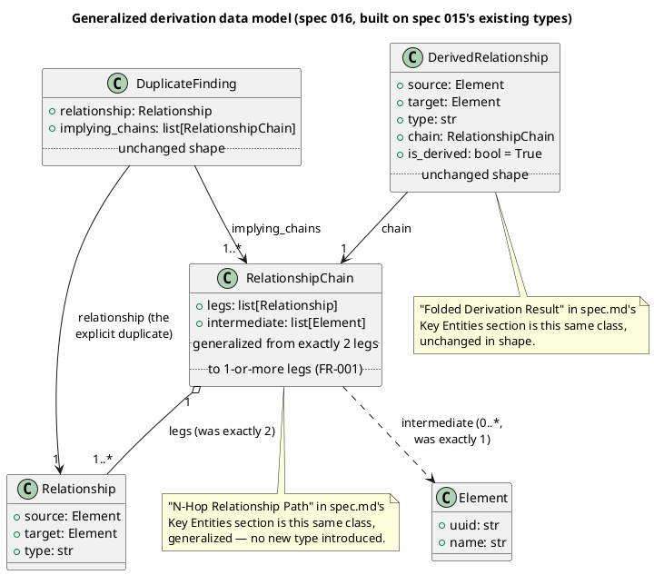

# Phase 1 Data Model: Generalize Derivation to N-Hop Chains

This feature generalizes two existing transient entities (from spec 015-derived-relationships) rather than introducing persisted data. Nothing here is ever written to a `Model`, a `Relationship`, or a view file — every entity below exists only as a query/report result.

## Entities

### `RelationshipChain` (existing, generalized in place)

An ordered sequence of one or more existing, explicit relationships, each sharing an intermediate element with the next, with no element repeated across the sequence.

| Field | Type | Notes |
|---|---|---|
| `legs` | `list[Relationship]` | **CHANGED**: was a fixed `leg1`/`leg2` pair (exactly 2); generalized to an ordered list of 1 or more relationships. A length-2 list reproduces today's exact shape and behavior. |
| `intermediate` (property) | `Element` | **CHANGED**: was a single property (the one shared element between `leg1`/`leg2`); generalized to the list of every intermediate element along the path (`len(legs) - 1` of them), still a property for backward-compatible single-intermediate access when `len(legs) == 2`. |

**Validation rules** (unchanged in kind, generalized in scope):
- No element appears more than once across the full sequence of endpoints (FR-004, generalizing the existing two-step `leg2.target != leg1.source` check to a running visited-set).
- Every leg's source and target element must be present in the model (FR-008, unchanged from spec 015).
- Every leg's type must be in the supported set, optionally extended by `include_dependency` (FR-009, unchanged).

**Note on public shape**: Whether this is implemented as a literal field rename (`leg1`/`leg2` → `legs`) or as a backward-compatible subclass/property shim is an implementation choice for `/speckit-tasks`; either way, FR-010/SC-003 requires that any code (inside or outside this library) relying on `chain.leg1`/`chain.leg2` for a 2-element chain continues to work unchanged when the caller does not opt into `max_chain_length > 2`.

### `N-Hop Relationship Path` (spec-level name for the generalized `RelationshipChain`)

The spec's Key Entities section names this as the generalized entity; it is the same object as `RelationshipChain` above once generalized — no separate class is introduced. Listed here only to map the spec's business-facing entity name onto the one concrete implementation type.

### `DerivedRelationship` (existing, unchanged shape)

| Field | Type | Notes |
|---|---|---|
| `source` | `Element` | Unchanged — the path's first leg's source. |
| `target` | `Element` | Unchanged — the path's last leg's target. |
| `type` | `str` | Unchanged — the fully-folded derived type after repeated `derive_pair_type` application across every leg. |
| `chain` | `RelationshipChain` | Unchanged field name and type; now may reference a chain of any length (see above). |
| `is_derived` | `bool` | Unchanged, always `True`. |

No field changes are required on `DerivedRelationship` itself — it already holds a reference to a whole `RelationshipChain`, so generalizing that chain's internal shape is sufficient; callers that print or inspect a `DerivedRelationship` (via `__str__`/`__repr__`) see the same `«derived» A -Type-> B` shape regardless of chain length.

### `Folded Derivation Result` (spec-level name for the generalized `DerivedRelationship`)

Same mapping note as `N-Hop Relationship Path` above: this is the spec's business-facing name for the existing `DerivedRelationship` type, unchanged in shape.

### `DuplicateFinding` (existing, unchanged shape)

| Field | Type | Notes |
|---|---|---|
| `relationship` | `Relationship` | Unchanged. |
| `implying_chains` | `list[RelationshipChain]` | Unchanged field name and type; each entry may now be a chain of any length (FR-005). |

## New parameter (not an entity, documented here for completeness)

| Name | Type | Default | Applies to |
|---|---|---|---|
| `max_chain_length` | `int` | `2` | `find_chains`, `derive_between`, `find_duplicate_relationships`, `Model.derive_relationship`, `Model.check_derivable_duplicates` |
| `allow_exceeding_default_ceiling` | `bool` (keyword-only) | `False` | Same five entry points — required `True` to pass `max_chain_length` above `DEFAULT_MAX_CHAIN_LENGTH_CEILING` (research.md Decision 2) |

## Relationships between entities

## State / lifecycle

None of these entities have a lifecycle or persisted state — each is constructed fresh per scan or query call and discarded once the caller is done with it (same guarantee as spec 015, generalized to any chain length per FR-004/FR-006 of this spec).
