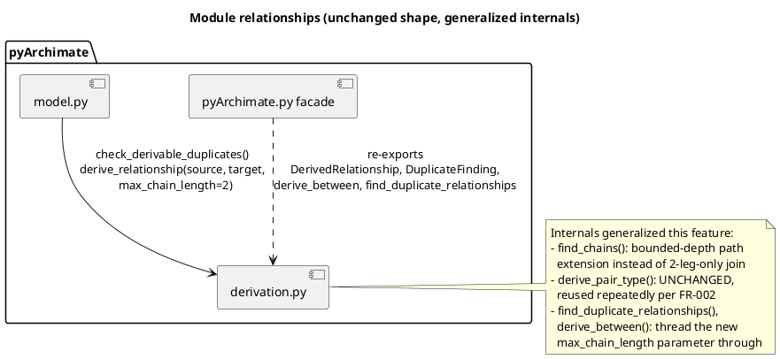

# Implementation Plan: Generalize Derivation to N-Hop Chains

**Branch**: `016-derivation-n-hop` | **Date**: 2026-11-14 | **Spec**: [spec.md](./spec.md)
**Input**: Feature specification from `/specs/016-derivation-n-hop/spec.md`

**Note**: This template is filled in by the `/speckit-plan` command; its definition describes the execution workflow.

## Summary

Generalize the existing `derivation.py` module (spec 015-derived-relationships, GitHub issues #140/#146) so that `find_chains`, `derive_between`, and `find_duplicate_relationships` fold relationship chains of any length (not only exactly two legs) by repeatedly applying the existing `derive_pair_type` rule left-to-right, short-circuiting the moment any adjacent pair has no defined rule. A single new `max_chain_length: int = 2` parameter (default preserves today's two-step-only behavior exactly) opts callers into longer-chain discovery, bounded by a library-enforced default ceiling that callers can explicitly override once they accept the documented performance tradeoff. This is purely additive: no existing public signature's default behavior changes, no new persistence, no new dependencies.

## Technical Context

**Language/Version**: Python 3.11+ (per `pyproject.toml` `requires-python = ">=3.11,<3.15"`; ruff targets 3.12)
**Primary Dependencies**: None new — stdlib only (`dataclasses`, `itertools`), plus existing `pyArchimate` modules (`model.py`, `relationship.py`, `enums.py`, `constants.py`) already used by `derivation.py`
**Storage**: N/A — library, file I/O only via the existing `Model`/reader classes; this feature performs no writes
**Testing**: pytest (unit tests for N-hop folding/short-circuit/cycle-safety logic and the new parameter's default-unchanged guarantee), behave (BDD acceptance scenarios extending `tests/features/steps/derivation_steps.py`), plus a benchmark addition to `tests/performance/test_performance_benchmarks.py` for SC-004
**Target Platform**: Cross-platform library (Linux/macOS/Windows), same as the rest of pyArchimate
**Project Type**: Library (single project) — extends the existing `derivation.py` module, no new CLI or network surface
**Performance Goals**: Discovering chains up to the default `max_chain_length=2` ceiling must show no measurable regression vs. today; discovering longer chains (opt-in) must scale predictably with chain length and model density, documented per FR-013, and complete on a ~1,000-element benchmark model (the scale already used in `tests/performance/test_performance_benchmarks.py`) in a time comparable to today's two-step-only scan on an equivalent-size model (SC-004)
**Constraints**: MUST NOT mutate the source model or any view file (inherited from spec 015 FR-004/FR-006); MUST NOT change the default-call result of any existing public function/method (FR-010, SC-003); MUST NOT invent any derivation rule beyond repeated application of the existing two-leg table (FR-002)
**Scale/Scope**: Models with up to tens of thousands of relationships at the default two-step depth; a documented, overridable ceiling bounds how deep a caller may search beyond that (FR-011)

## Constitution Check

*GATE: Must pass before Phase 0 research. Re-check after Phase 1 design.*

- **I. Code Quality**: The generalization stays inside `derivation.py`, replacing the two-leg-specific walk in `find_chains` with a bounded-depth path extension that reuses the existing `derive_pair_type`, `_qualifies_for_chaining`, and `_index_qualifying_by_source` helpers unchanged. No new module, no function over 30 lines by decomposing path-extension into a small recursive/iterative helper. PASS.
- **II. Testing Standards**: Plan adds unit tests for 3-hop and 4-hop folding (SC-001), short-circuit-on-undefined-pair (SC-002), N-hop cycle protection (FR-004), the `max_chain_length` default-unchanged guarantee (SC-003), and a benchmark test (SC-004) — written before implementation per Red-Green-Refactor. PASS.
- **III. UX Consistency**: `max_chain_length` is added as one keyword parameter with the same default-preserving convention already used for `include_dependency` (issue #146 precedent) on every entry point (`find_chains`, `derive_between`, `find_duplicate_relationships`, and the `Model` wrapper methods). PASS.
- **IV. Performance**: Path extension is pruned the instant an adjacent pair fails to fold (fused into discovery, not a separate fold-after-discover pass), avoiding combinatorial generation of paths that can never produce a result; the documented default ceiling (FR-011) keeps worst-case cost bounded unless a caller explicitly overrides it. PASS.
- **V. Security**: No new external input parsing, no new file I/O, no new attack surface — `max_chain_length` is a plain bounded integer. PASS.
- **VI. State Management**: No new persisted state; outputs remain explicitly transient dataclasses, same as spec 015 (FR-006/FR-007 there). PASS.
- **VII. System Integrity & Accuracy**: PASS. No new derivation rule is introduced — `derive_pair_type`'s existing DR2/DR3/DR5/DR7/DR8 table (verified against a primary copy of ArchiMate 3.2 Appendix B.2 during spec 015's planning) is reused unchanged and only applied repeatedly, per FR-002. The documentation correction required by FR-012 directly serves this principle by removing a statement that previously misrepresented what the underlying rule covers.
- **VIII. Durability & Interoperability**: No existing format, writer, or reader behavior changes; purely additive to an already read-only module. PASS.
- **IX. Cross-Platform Consistency**: Pure Python stdlib logic, no OS-specific behavior. PASS.

No violations requiring Complexity Tracking.



## Project Structure

### Documentation (this feature)

```text
specs/016-derivation-n-hop/
├── plan.md              # This file (/speckit-plan command output)
├── research.md          # Phase 0 output (/speckit-plan command)
├── data-model.md        # Phase 1 output (/speckit-plan command)
├── quickstart.md        # Phase 1 output (/speckit-plan command)
├── contracts/           # Phase 1 output (/speckit-plan command)
│   └── derivation-api.md
├── checklists/
│   └── requirements.md
└── tasks.md             # Phase 2 output (/speckit-tasks command - NOT created by /speckit-plan)
```

### Source Code (repository root)

```text
# Single project (library) — matches existing pyArchimate layout; no new top-level packages

src/pyArchimate/
├── derivation.py              # MODIFIED: generalize find_chains() to bounded-depth path extension;
│                               #           thread max_chain_length through derive_between(),
│                               #           find_duplicate_relationships(); add module-level
│                               #           DEFAULT_MAX_CHAIN_LENGTH_CEILING constant; correct
│                               #           module docstring per FR-012
├── model.py                   # MODIFIED: thread max_chain_length (default 2) through
│                               #           check_derivable_duplicates() and derive_relationship(),
│                               #           mirroring the existing include_dependency pattern
├── pyArchimate.py              # UNCHANGED: existing re-exports already cover the generalized
│                               #            functions/dataclasses, no new public names needed
├── relationship.py             # UNCHANGED: reused for concept-type lookups only
├── enums.py                    # UNCHANGED
└── constants.py                 # UNCHANGED

tests/
├── unit/
│   └── test_derivation.py      # MODIFIED: add 3-hop/4-hop folding, short-circuit, N-hop cycle,
│                                #           and max_chain_length default-unchanged test cases
├── integration/
│   └── test_derivation_roundtrip.py  # MODIFIED: add longer-chain duplicate-scan and
│                                      #           derive_between scenarios, file-immutability
│                                      #           re-asserted for the new parameter
├── features/
│   └── steps/derivation_steps.py     # MODIFIED: step definitions for the new N-hop
│                                      #           acceptance scenarios (User Stories 1–3)
└── performance/
    └── test_performance_benchmarks.py  # MODIFIED: add an N-hop duplicate-scan benchmark
                                         #            at the existing ~1,000-element model scale (SC-004)
```

**Structure Decision**: No structural change to the existing single-project library layout. This feature modifies two existing files (`derivation.py`, `model.py`) and extends four existing test files; it adds no new source module, no new top-level package, and no new public name beyond the one new keyword parameter — consistent with spec 015's own precedent for the `include_dependency` opt-in (issue #146).

## Complexity Tracking

*No constitution violations — table not needed.*
