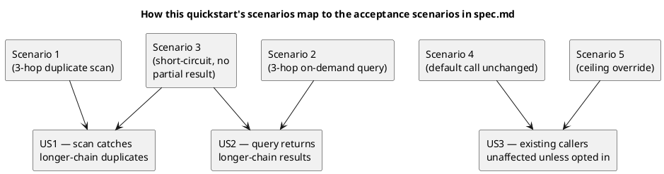

# Quickstart: Validating N-Hop Derivation

## Prerequisites

- Repo dependencies installed: `poetry install`
- Familiarity with the spec 015 quickstart (`specs/015-derived-relationships/quickstart.md`) — every scenario below extends that one; the two-step behavior it documents is unchanged by this feature (SC-003).



## Scenario 1 — Scan catches a duplicate implied by a three-step chain (User Story 1)

```python
from pyArchimate import Model

model = Model()
a = model.add("ApplicationComponent", name="A")
b = model.add("ApplicationComponent", name="B")
c = model.add("ApplicationComponent", name="C")
d = model.add("ApplicationComponent", name="D")

model.add_relationship("Composition", a, b)
model.add_relationship("Aggregation", b, c)
model.add_relationship("Realization", c, d)
# This duplicates what the three-step chain above already implies:
duplicate = model.add_relationship("Realization", a, d)

# Default call (max_chain_length=2) does NOT see this — it's a 3-hop chain:
assert model.check_derivable_duplicates() == []

# Opt in to 3-hop discovery:
findings = model.check_derivable_duplicates(max_chain_length=3)

assert len(findings) == 1
assert findings[0].relationship is duplicate
assert len(findings[0].implying_chains[0].legs) == 3
```

**Expected outcome**: with default settings, nothing is reported (matches today's behavior exactly). With `max_chain_length=3`, exactly one `DuplicateFinding` is reported, citing the full three-relationship chain.

## Scenario 2 — Query the relationship implied across a three-step chain (User Story 2)

```python
from pyArchimate import Model

model = Model()
a = model.add("ApplicationComponent", name="A")
b = model.add("ApplicationComponent", name="B")
c = model.add("ApplicationComponent", name="C")
d = model.add("ApplicationComponent", name="D")

model.add_relationship("Composition", a, b)
model.add_relationship("Aggregation", b, c)
model.add_relationship("Realization", c, d)
# No explicit relationship between A and D.

assert model.derive_relationship(a, d) == []  # default call: unchanged
results = model.derive_relationship(a, d, max_chain_length=3)

assert len(results) == 1
assert results[0].type == "Realization"  # Composition+Aggregation -> Aggregation; Aggregation+Realization -> Realization
assert len(results[0].chain.legs) == 3
```

**Expected outcome**: one `DerivedRelationship` between A and D, citing the full 3-leg chain, with the type correctly folded left-to-right (Composition+Aggregation→Aggregation, then Aggregation+Realization→Realization).

## Scenario 3 — A chain with one undefined pair yields no partial result (FR-003/SC-002)

```python
from pyArchimate import Model

model = Model()
a = model.add("ApplicationComponent", name="A")
b = model.add("ApplicationComponent", name="B")
c = model.add("ApplicationComponent", name="C")
d = model.add("ApplicationComponent", name="D")

model.add_relationship("Composition", a, b)
model.add_relationship("Flow", b, c)        # Flow+Flow / Flow+structural has no defined rule (see derivation.py docstring)
model.add_relationship("Flow", c, d)

results = model.derive_relationship(a, d, max_chain_length=3)
assert results == []  # not a partial result based on the first leg only
```

**Expected outcome**: no derivation at all for this chain — the undefined second-leg pair stops folding entirely, it does not fall back to any partial answer.

## Scenario 4 — Existing default-settings calls are provably unaffected (User Story 3)

```python
from pyArchimate import Model

model = Model()
# ... build any model with both 2-hop and 3+-hop qualifying chains ...

before = model.check_derivable_duplicates()  # default max_chain_length=2
after = model.check_derivable_duplicates()   # same call again, no new argument
assert before == after  # byte-for-byte identical, no new findings appear uninvited
```

**Expected outcome**: this is the same assertion spec 015's quickstart already demonstrates (Scenario 1 there) — included here only to make explicit that calling with no new argument is unaffected by this feature shipping.

## Scenario 5 — Exceeding the default ceiling requires an explicit override (FR-011)

```python
from pyArchimate import Model

model = Model()
# ... any model ...

try:
    model.check_derivable_duplicates(max_chain_length=10)
    assert False, "expected ValueError"
except ValueError:
    pass

# Explicit acknowledgement of the performance tradeoff required:
model.check_derivable_duplicates(max_chain_length=10, allow_exceeding_default_ceiling=True)
```

**Expected outcome**: raising `max_chain_length` past `derivation.DEFAULT_MAX_CHAIN_LENGTH_CEILING` without the override raises `ValueError`; passing the override allows it.

## Running these as real tests

The scenarios above are formalized in:
- `tests/unit/test_derivation.py` (N-hop folding, short-circuit, cycle-safety, and ceiling-override unit coverage)
- `tests/integration/test_derivation_roundtrip.py` (end-to-end longer-chain duplicate/query scenarios, file-immutability re-verified)
- `tests/features/steps/derivation_steps.py` (BDD scenarios for User Stories 1–3)
- `tests/performance/test_performance_benchmarks.py` (SC-004 benchmark at `max_chain_length=2` vs. a longer opt-in value)

Run with:

```bash
poetry run pytest tests/unit/test_derivation.py tests/integration/test_derivation_roundtrip.py tests/performance/test_performance_benchmarks.py -v
poetry run behave tests/features --tags=derivation
```
