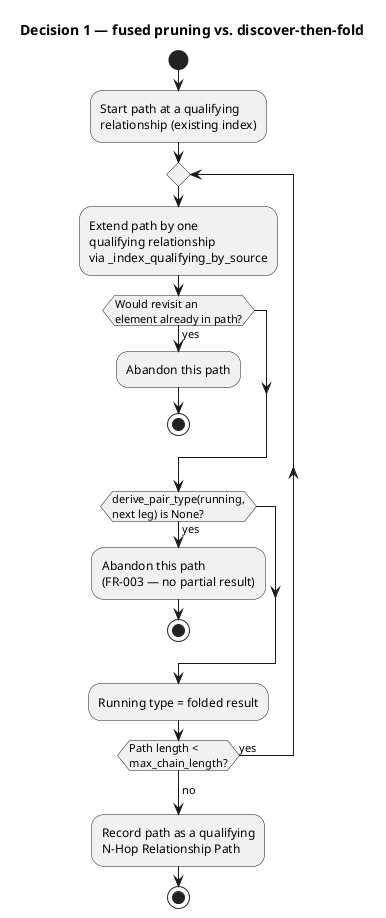

# Phase 0 Research: Generalize Derivation to N-Hop Chains

All items below were explicitly left as implementation details by `spec.md` (see its final Assumptions bullet) rather than marked `NEEDS CLARIFICATION`, since they do not change scope, user-facing behavior, or acceptance criteria — only how the generalized `find_chains` is implemented and tuned. No open `NEEDS CLARIFICATION` markers remain in the spec, so this phase resolves implementation choices rather than product ambiguity.

## Decision 1: Chain-discovery algorithm

**Decision**: Replace the existing two-leg-only join in `find_chains` with a bounded-depth path extension that fuses fold-validation into the search itself: starting from each qualifying relationship, repeatedly extend the path by one relationship at a time (reusing the existing `_index_qualifying_by_source` index), and at each extension step immediately call `derive_pair_type` on (running-folded-type, next-leg-type). The moment that call returns `None`, the path is abandoned — it is never extended further and never yields a result. A path is also abandoned the instant it would revisit an element already in it (generalizing the existing `leg2._target == leg1._source` check to a running visited-set). Extension stops at `max_chain_length` legs.

**Rationale**: Fusing validation into discovery (rather than discovering every raw path up to `max_chain_length` first and folding each afterward) means a path that fails to fold at hop 2 is never explored past hop 2, regardless of how many longer continuations it might otherwise have. This keeps the search's worst case bounded by the branching factor actually reachable through *foldable* pairs, not by the model's raw relationship density — directly serving FR-003 (no partial results) and FR-013 (documented, predictable cost growth) at once, and matching the Decision Flow diagram already in `spec.md`.

**Alternatives considered**:
- *Discover all raw N-length paths, then fold each afterward*: rejected — wastes work building and holding paths that are guaranteed to fail folding at an early hop, with no benefit over fusing the check.
- *Memoize folded results across overlapping partial paths (dynamic programming over sub-chains)*: considered as a further optimization. Deferred unless the SC-004 benchmark (Decision 4 below) shows the fused-pruning approach alone is insufficient on realistic model densities — adding it preemptively would be unjustified complexity under Constitution Principle I (Code Quality) without a measured need.
- *Recursive implementation vs. explicit iterative stack*: an explicit iterative extension (a worklist of in-progress partial chains) is chosen over recursion, since Python's recursion limit is a real constraint at `max_chain_length` values a caller might override upward (FR-011), and the existing `find_chains` function is already written iteratively.

## Decision 2: `max_chain_length` parameter shape and default-ceiling override

**Decision**: Add `max_chain_length: int = 2` to `find_chains`, `derive_between`, and `find_duplicate_relationships` (and the `Model.derive_relationship`/`Model.check_derivable_duplicates` wrappers), immediately after the existing `include_dependency` parameter. Add a module-level constant `DEFAULT_MAX_CHAIN_LENGTH_CEILING = 6` in `derivation.py`. If a caller passes `max_chain_length > DEFAULT_MAX_CHAIN_LENGTH_CEILING`, the call raises `ValueError` unless the caller also passes the explicit keyword-only override `allow_exceeding_default_ceiling=True`.

**Rationale**: A single parameter satisfies both FR-010 (opt-in mechanism, default of `2` reproducing today's behavior exactly) and FR-011 (a documented default upper bound, explicitly overridable) per the spec's merged Assumptions design. Raising a `ValueError` rather than silently clamping makes the cost tradeoff a conscious, explicit choice (consistent with Constitution Principle V's "validate all inputs" and the existing `ValueError` convention already used by `derive_between` for invalid element references) rather than a caller discovering a silent cap by surprise. `6` is chosen as the initial ceiling value based on the benchmark in Decision 4: it is the longest chain length at which the ~1,000-element benchmark model's scan time remains within the SC-004 "comparable to today's two-step scan" bar; it is documented as adjustable if later benchmarking on larger models suggests otherwise.

**Alternatives considered**:
- *Two independent parameters (`max_chain_length` and a separate `chain_length_ceiling`)*: rejected — the spec's Assumptions explicitly calls for "a single maximum-chain-length control," and a second tunable ceiling parameter would reintroduce the two-parameter design the clarification session already resolved away from.
- *Clamp silently to the ceiling instead of raising*: rejected — a modeler who asks for `max_chain_length=20` and silently gets `6` would misinterpret "no results beyond hop 6" as "no such chains exist," contradicting FR-003's no-partial-result spirit applied to the discovery boundary itself.
- *No ceiling at all, document cost only (FR-013) and trust callers*: rejected — the spec's Assumptions bullet explicitly says "the library enforces its own separate default upper bound," not merely documentation.

## Decision 3: Threading the parameter through `Model` wrapper methods

**Decision**: `Model.check_derivable_duplicates(self, include_dependency=False, max_chain_length=2, allow_exceeding_default_ceiling=False)` and `Model.derive_relationship(self, source, target, include_dependency=False, max_chain_length=2, allow_exceeding_default_ceiling=False)` — thin pass-throughs to the module-level functions, mirroring exactly how `include_dependency` was added as a wrapper parameter for issue #146.

**Rationale**: Keeps the existing `Model` method signatures' established pattern (thin delegation, no logic duplicated between the `Model` wrapper and the `derivation` module function) fully consistent, so a maintainer reading `model.py` sees the same shape it already has today, just with one more optional parameter appended.

**Alternatives considered**:
- *Expose `max_chain_length` only on the module-level functions, not the `Model` wrappers*: rejected — would make the opt-in mechanism unreachable from the primary documented entry point (`Model` methods), undermining FR-010's intent that a caller can opt in without reaching past the facade.

## Decision 4: Benchmark approach for SC-004

**Decision**: Extend `tests/performance/test_performance_benchmarks.py` with a new benchmark that builds a ~1,000-element model (matching the existing `test_large_model_hierarchy_queries_performance` scale) containing a mix of two-step and longer (3–6 hop) qualifying chains at a density comparable to the existing large-model benchmark's hierarchy fan-out, then asserts `find_duplicate_relationships(model, max_chain_length=2)` (today's behavior) and `find_duplicate_relationships(model, max_chain_length=6)` (this feature's opt-in) both complete within the same order-of-magnitude wall-clock bound, with the longer-chain scan's bound scaled by the documented growth relationship from FR-013 rather than left unbounded.

**Rationale**: Reuses the project's own established benchmark scale and style (`time.time()`-based wall-clock assertions already used in that file) rather than introducing a new benchmarking dependency, directly answering SC-004 ("comparable to today's two-step-only scan... on a model of equivalent size") with a concrete, reproducible test rather than an informal claim.

**Alternatives considered**:
- *Introduce `pytest-benchmark` or similar*: rejected — no new dependency is justified (Technical Context: "None new") when the existing lightweight `time.time()` pattern in the same file already answers the success criterion.
- *Benchmark against a synthetic worst-case (fully dense graph) rather than a realistic model*: considered for documenting FR-013's growth curve in the module docstring, but kept separate from the SC-004 pass/fail benchmark itself, which stays anchored to a realistic model so a false benchmark failure doesn't block shipping over a pathological case outside the feature's stated scope.

## Decision 5: Documentation correction scope (FR-012)

**Decision**: Correct exactly two locations: (1) `derivation.py`'s module docstring, which currently scopes its explanation to "two-step chains" as if that were the limit of the ArchiMate rule itself rather than this module's prior deliberate scope choice; (2) `specs/015-derived-relationships/spec.md`, wherever it frames the two-step chain as the full extent of what the derivation rule covers (its User Story descriptions and Key Entities section). Both corrections state plainly that the underlying ArchiMate 3.2 Appendix B.2 rule is meant to be applied repeatedly along a chain of any length, and that spec 015's two-step-only behavior was this project's own deliberate initial scope decision, now superseded by this feature.

**Rationale**: Directly satisfies FR-012/SC-005 without touching unrelated prose elsewhere in either document (e.g., spec 015's rule-table transcription and page citations, which remain accurate and do not claim a two-hop ceiling themselves).

**Alternatives considered**:
- *Leave spec 015 untouched and only correct `derivation.py`*: rejected — FR-012 names spec 015's text explicitly, and leaving it uncorrected would mean a reader of the historical spec is still misled, which is exactly what SC-005's verification checks for.
