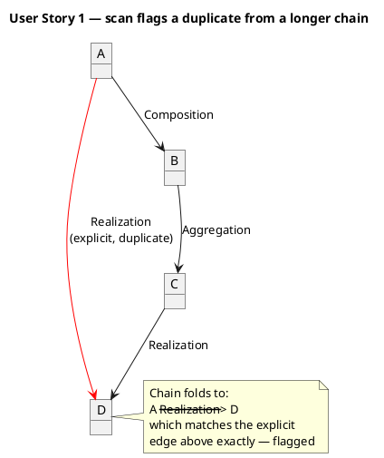
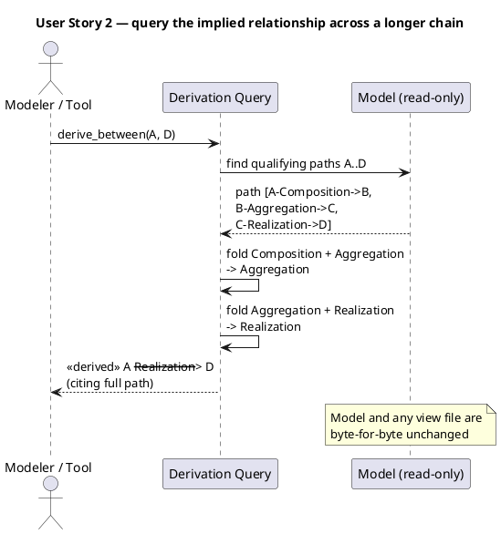
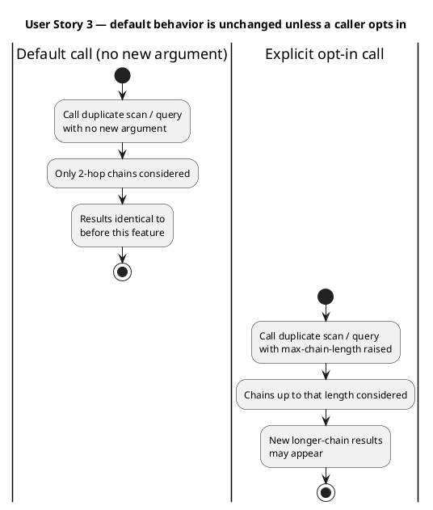
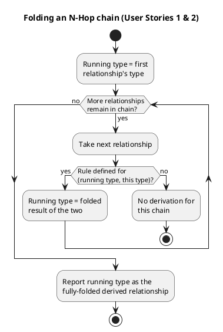

# Feature Specification: Generalize Derivation to N-Hop Chains

**Feature Branch**: `016-derivation-n-hop`

**Created**: 2026-11-14

**Status**: Draft

**Input**: User description: "GitHub issue #173: Generalize derivation to N-hop chains, not just two-step. `derive_pair_type`/`find_chains`/`derive_between` in `src/pyArchimate/derivation.py` only ever fold exactly two relationship legs (`A→B→C`) into one implied relationship. The ArchiMate 3.2 Appendix B.2 rule table is not inherently limited to two hops: it defines how to fold two relationships into their implied type, and that folding is meant to be applied repeatedly along a path of arbitrary length — the implied result of legs 1+2 becomes the new leg 1 when combined with leg 3, and so on. Today, a model with a three-hop chain (e.g. Composition→Aggregation→Realization) gets no derivation at all for the endpoints, even though folding left-to-right is just two ordinary applications of the existing two-step rule in sequence. Request: generalize the existing module to fold derivation rules along chains of arbitrary length, while preserving every existing guarantee (never persisted, cycle-safe, independently-reported multiple chains, the existing opt-in extended scope). This is additive to the existing two-step derivation feature (spec 015-derived-relationships, GitHub issues #140/#146); existing two-step-only results must remain unchanged for existing callers."

## User Scenarios & Testing *(mandatory)*

### User Story 1 - Find redundant explicit relationships that duplicate a longer implied chain (Priority: P1)

A modeler has a model where a chain of three or more relationships (e.g., A is Composed of B, B Aggregates C, C Realizes D) already implies a direct relationship between A and D, per the same derivation rule that already covers two-step chains. Somewhere else in the model, an explicit relationship of that implied type already exists directly between A and D, duplicating what the longer chain implies. Today's duplicate scan (spec 015) only catches this for two-step chains and misses it here. The modeler wants the existing scan to also catch this longer case, so they get one comprehensive report regardless of chain length.

**Why this priority**: This extends the single highest-value capability from the original derived-relationships feature (duplicate detection) to the cases it currently silently misses. Without it, a modeler only gets partial, length-dependent coverage from a scan that is supposed to answer "does any explicit relationship duplicate something implied elsewhere in the model?"

**Independent Test**: Can be fully tested by running the existing duplicate scan against a model containing a qualifying three-or-more-step chain and an explicit relationship duplicating its implied result, and confirming the scan reports it — independently of whether any two-step chains are also present.

**Acceptance Scenarios**:

1. **Given** a model with elements A, B, C, D where A→B→C→D forms a qualifying three-step chain (every adjacent pair has a defined derivation rule) and an explicit relationship of the fully-folded implied type already exists directly between A and D, **When** the scan is run, **Then** the report includes that explicit relationship, identifies it as duplicating the derivation, and cites the full three-relationship chain that implies it.
2. **Given** the same model but without any explicit relationship directly between A and D, **When** the scan is run, **Then** the report does not flag anything for the pair (A, D).
3. **Given** a model with a four-step chain where every adjacent pair has a defined rule, **When** the scan is run, **Then** the chain is folded correctly across all four steps and any duplicating explicit relationship is still correctly flagged.
4. **Given** a model with a three-step chain where the second adjacent pair (leg 2 and leg 3) has no defined derivation rule, **When** the scan is run, **Then** no derivation is reported for that chain at all — not a partial result based on only the first two legs.

---

### User Story 2 - Query the relationship implied between two elements connected only by a longer chain (Priority: P2)

A modeler (or a tool building on this library, such as a view renderer) has two elements with no explicit relationship between them, connected only through a chain of three or more relationships. They want to ask "what relationship is implied between these two elements, if any?" using the same on-demand query the two-step feature already provides, and get back the correctly folded type and the full chain that produces it — without anything being written to the model.

**Why this priority**: This is the render-time half of the original feature (spec 015, User Story 2), extended to the same longer-chain cases as User Story 1. It is lower priority than the scan because it is an on-demand query rather than a model-wide health check, but it closes the same length-dependent gap.

**Independent Test**: Can be fully tested by calling the existing derivation query against a pair of elements known to be connected only by a qualifying three-or-more-step chain, and confirming the model file and any view file are byte-for-byte unchanged after the query.

**Acceptance Scenarios**:

1. **Given** two elements connected by a single qualifying three-step chain and no explicit relationship between them, **When** the derived relationship is requested for that pair, **Then** the result identifies the fully-folded implied relationship type and references the complete chain that produced it.
2. **Given** two elements connected only by a chain containing an adjacent pair with no defined derivation rule, **When** the derived relationship is requested, **Then** the result indicates no derivation applies for that chain.
3. **Given** two elements connected by both a qualifying two-step chain and a separate qualifying three-step chain (via a different intermediate path), **When** the derived relationship is requested, **Then** both results are returned independently, each citing its own chain, consistent with how the existing two-step feature already handles multiple two-step chains between the same pair.
4. **Given** a model where the existing opt-in extended scope is enabled (Access/Influence/Association eligible to participate) and two elements are connected only by a qualifying chain of three or more relationships that relies on one of those three types for at least one leg, **When** the derived relationship is requested with that extended scope enabled, **Then** the result is folded correctly across the full chain, exactly as it would be for a chain built only from the default-scope types.

---

### User Story 3 - Existing callers see unchanged behavior unless they opt in (Priority: P3)

A maintainer who already depends on the existing two-step-only derivation behavior (the duplicate scan, the derivation query, or any consumer built on them) upgrades to a version of the library that includes this feature. They expect every existing call, made exactly as before, to return byte-for-byte identical results — no new duplicate findings or derived relationships should appear unless they take an explicit action to enable longer-chain discovery.

**Why this priority**: This is a safety/compatibility guarantee rather than new capability, so it is lower priority to demonstrate on its own, but it gates whether User Stories 1 and 2 can ship without being a breaking change for existing consumers (see spec 015 and GitHub issue #146, which established this additive-opt-in precedent for extending scope).

**Independent Test**: Can be fully tested by re-running the existing (pre-this-feature) test suite and any existing example models through the upgraded module using default settings only, and confirming every result matches what the prior version produced.

**Acceptance Scenarios**:

1. **Given** a model and a call to the duplicate scan or derivation query using only default settings, **When** compared against the same call made before this feature existed, **Then** the set of reported results is identical.
2. **Given** a model containing a qualifying longer-than-two-step chain, **When** the duplicate scan or derivation query is called with default settings, **Then** no result for that longer chain appears unless the caller has explicitly enabled longer-chain discovery.

---

### Decision Flow: Folding a Chain of Any Length

The following diagram explains the folding mechanics referenced by User Stories 1 and 2 above.

### Edge Cases

- What happens when a chain of length three or more revisits an element it has already passed through (e.g., A→B→C→B)? The derivation MUST NOT produce a derived relationship from such a chain, generalizing the existing two-step self-reference protection (A→B→A) to chains of any length.
- What happens when a chain includes a relationship type outside the currently supported subset, at any position in the chain (not just the first or last leg)? That chain MUST be skipped for derivation, consistent with existing two-step behavior.
- What happens when two elements are connected by multiple qualifying chains of different lengths (e.g., a two-step chain and a separate four-step chain) that imply different relationship types? Each qualifying chain is evaluated and reported independently; the feature does not attempt to reconcile, merge, or rank results by chain length.
- What happens when a chain is long enough, or the model dense enough, that discovering all qualifying chains becomes computationally expensive? The feature's behavior under this condition is addressed by FR-011 below.
- How does the longer-chain scan behave on a model with relationships that reference elements not present in the model (dangling references)? Such relationships are excluded from chain construction at any position in the chain, consistent with existing two-step behavior.

## Requirements *(mandatory)*

### Functional Requirements

- **FR-001**: System MUST discover relationship chains containing more than two relationships (more than one intermediate element) connecting a source and target element, in addition to the two-step chains the existing feature already discovers.
- **FR-002**: System MUST compute the relationship implied by a chain of any length by applying the existing two-relationship derivation rule repeatedly along the chain — folding the result of combining the first two relationships with the third, that result with the fourth, and so on — without introducing any new combination rule beyond what repeated application of the existing rule table already yields.
- **FR-003**: System MUST stop folding a chain and report no derivation for that chain the moment any two adjacent relationships being combined (whether original or already-folded) have no defined derivation rule between them, rather than skipping the undefined step and continuing with a partial result.
- **FR-004**: System MUST NOT produce a derived relationship from a chain that revisits any element already present earlier in that same chain, for chains of any length.
- **FR-005**: The existing duplicate-relationship scan MUST also report an explicit relationship that duplicates a relationship implied by a chain of more than two relationships, citing the full chain that implies it, using the same reporting shape already used for two-step chains.
- **FR-006**: The existing two-element derivation query MUST also return a result for an element pair connected only by a chain of more than two relationships, citing the full chain, using the same result shape already used for two-step chains.
- **FR-007**: When multiple independently-qualifying chains of different lengths connect the same pair of elements, System MUST evaluate and report each chain's result independently, never merging or ranking results by chain length — consistent with how the existing feature already treats multiple two-step chains between the same pair.
- **FR-008**: System MUST exclude from chain construction, at any position in a chain of any length, any relationship that references an element absent from the model — consistent with existing two-step behavior.
- **FR-009**: The existing opt-in extended scope (which allows Access, Influence, and Association to participate in chains) MUST remain available and behave consistently for chains of any length, not only two-step chains. This MUST be verifiable specifically for chains longer than two relationships, not only inferred from the two-step case — see User Story 2, Acceptance Scenario 4.
- **FR-010**: System MUST expose a single maximum-chain-length control on the duplicate scan and derivation query, defaulting to exactly two relationships per chain. Every existing call that does not explicitly pass this control MUST return results identical to those returned before this feature existed. A caller opts into longer-chain discovery solely by explicitly raising this control's value.
- **FR-011**: System MUST enforce a documented default upper bound on how large a value a caller may set the maximum-chain-length control to, so that chain-discovery cost stays predictable without the caller having to reason about combinatorial growth themselves. A caller who needs a chain longer than this default upper bound MUST be able to explicitly override it, with the performance tradeoff of doing so documented alongside the control.
- **FR-012**: The existing documentation that frames two-step chains as the full extent of what the ArchiMate derivation rule covers — specifically the derivation module's own explanatory documentation and spec 015-derived-relationships' specification text — MUST be corrected to state that the underlying rule is not inherently limited to two hops, and that the prior two-step-only behavior was a deliberate scope decision for the original feature rather than a reflection of the rule itself. This correction MUST ship together with this feature, not be deferred.
- **FR-013**: System MUST document how chain-discovery cost grows as chain length and model size/density increase, in terms a caller can use to decide how far above the default to raise the maximum-chain-length control (FR-010) before accepting a given cost — so a caller is never left to discover the growth pattern by trial and error.

### Key Entities

- **N-Hop Relationship Path**: An ordered sequence of three or more existing, explicit relationships, each sharing an intermediate element with the next, with no element repeated across the sequence. Generalizes the existing two-relationship "Relationship Chain" entity (spec 015) to any length greater than two; used as the input to the generalized derivation rule.
- **Folded Derivation Result**: The relationship type, source, and target computed by repeatedly applying the existing two-relationship derivation rule along an N-Hop Relationship Path. Exists only transiently as a query/report result, never persisted — identical in nature to the existing "Derived Relationship" entity (spec 015), generalized to cite a path of any length rather than exactly two relationships.

## Success Criteria *(mandatory)*

### Measurable Outcomes

- **SC-001**: A modeler with a model containing a three-relationship chain where every adjacent pair has a defined derivation rule receives a correctly folded derived relationship for the full chain, verified by at least one three-relationship and one four-relationship test case.
- **SC-002**: A modeler with a model containing a chain where any single adjacent pair lacks a defined derivation rule receives zero derived relationships for that chain — no partial or guessed result is ever produced.
- **SC-003**: Every result produced by the existing two-step-only scan and query, run with default settings against the existing test model set, remains identical after this feature ships — zero regressions in existing behavior.
- **SC-004**: A modeler scanning a realistically large model (on the order of the largest model already used in this project's own test/benchmark suite) for duplicates, including longer chains, completes the scan in a time comparable to today's two-step-only scan on a model of equivalent size — no unbounded slowdown as chain length grows.
- **SC-005**: A reader of the derivation module's documentation and spec 015-derived-relationships, after this feature ships, finds no remaining statement claiming the ArchiMate derivation rule itself is limited to two-step chains — verified by a documentation review against FR-012.

## Assumptions

- When multiple qualifying chains of different lengths connect the same element pair, each is reported independently rather than preferring the shortest chain or merging results — this follows the precedent already established for multiple two-step chains in spec 015 (FR-010 there).
- The existing opt-in extended scope's one additional best-effort rule (Influence-then-structural) participates in multi-step folding the same way every other rule in the table does — no separate restriction limits it to exactly one extra hop.
- No new derivation rule is invented for any relationship-type combination beyond what already exists in the two-relationship rule table; a longer chain either folds successfully through already-defined rules at every step, or yields no derivation.
- This feature is purely additive: it extends the existing module (spec 015-derived-relationships) rather than replacing or restructuring its existing two-step-only public behavior.
- A single maximum-chain-length control serves both the opt-in mechanism (FR-010) and the cost bound (FR-011): its default value preserves today's two-step-only behavior, and the library enforces its own separate default upper bound on how high a caller may set it, overridable when a caller explicitly accepts the performance tradeoff. The exact numeric default and upper-bound values are implementation details to be determined during planning, informed by benchmarking against a representative model (SC-004) — this specification intentionally does not fix them.
