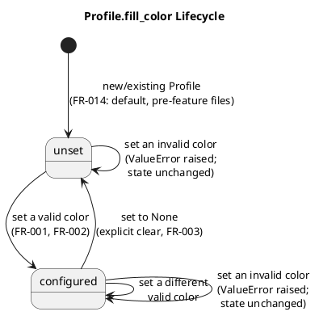
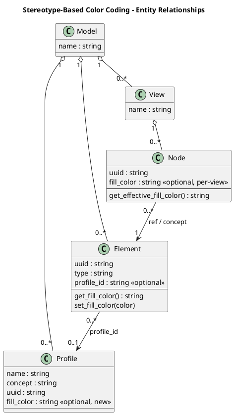
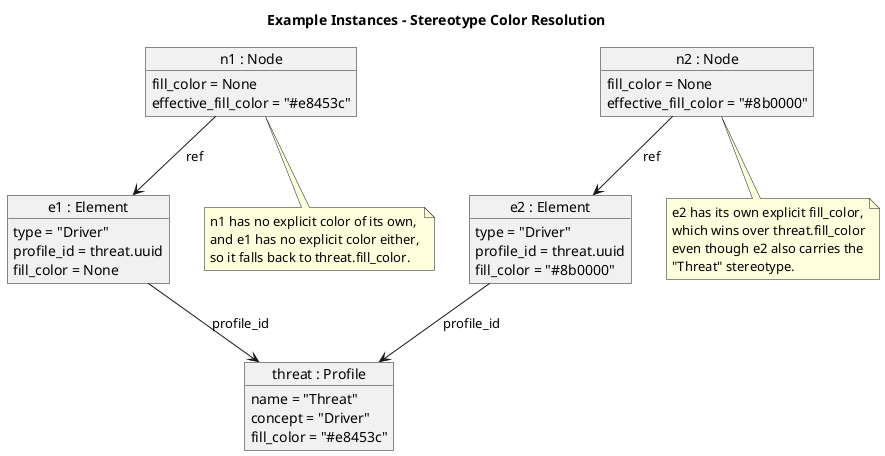

# Phase 1 Data Model: Stereotype-Based Color Coding

## Entities

### Profile (stereotype)

Existing class (`src/pyArchimate/view/__init__.py`), a named specialization of an `ArchiType` concept.

| Field | Type | Notes |
|---|---|---|
| `name` | `str` | Existing. Required, non-empty (unchanged). |
| `concept` | `str` (`ArchiType` value) | Existing. The concept type this profile specializes (unchanged). |
| `uuid` | `str` | Existing. Unique identifier (unchanged). |
| `fill_color` | `str \| None` | **New.** Normalized 6-digit hex (`"#rrggbb"`), or `None` when unset. Validated via the existing `_normalize_color()` helper on set — invalid input raises `ValueError`, matching `Element.set_fill_color()`'s existing behavior (FR-002). |

**Validation rules**:
- `fill_color` accepts the same inputs as `Element.set_fill_color()`: a 6-digit hex code (`#RRGGBB`) or a case-insensitive named color; anything else raises `ValueError` (FR-002).
- `fill_color` may be explicitly set back to `None` to clear it (FR-003).
- Concept type restrictions already enforced by `Profile.__init__` (must be a valid `ArchiType`, not `View`) are unchanged — this feature does not add new concept-type constraints.

**State / lifecycle**: Two states only — `unset` (default; new and pre-existing profiles both start here, satisfying FR-014) and `configured` (a valid color string). No intermediate states; transitions are: `unset → configured` (set a valid color), `configured → configured` (change to a different valid color), `configured → unset` (explicit clear, FR-003). An invalid value attempted from either state leaves the profile in its prior state (the setter raises before mutating).

### Element

Existing class (`src/pyArchimate/element.py`). No new persisted fields. Gains one new derived (computed, not stored) notion:

| Derived property | Type | Resolution |
|---|---|---|
| *(conceptual)* "non-standard stereotype" | `bool` | `True` when the element has an assigned profile whose `name`, lowercased, differs from the element's `type` (an `ArchiType` value), lowercased. Used only by the SVG exporter (FR-015). Not a new stored field — computed on demand from existing `profile_name` and `type`. |

No change to `Element.get_fill_color()` / `set_fill_color()` themselves (FR-013: this feature does not touch line color, line width, or transparency, and does not change how an element's *own* explicit color is stored — only how it participates in the new resolution chain described below).

### Node (view-level element instance)

Existing class (`src/pyArchimate/view/__init__.py`). No new persisted fields. Gains one new derived notion:

| Derived property | Type | Resolution |
|---|---|---|
| *(conceptual)* "effective fill color" | `str \| None` | See Decision 1 in `research.md`: `Node.fill_color` (if set) → else `Element.get_fill_color()` of the underlying concept (if set) → else the concept's `Profile.fill_color` (if assigned and configured) → else the existing type-based theme default. This is the value the SVG exporter must use when drawing the shape's fill (FR-011). |

## Relationships

All associations above (`Model`–`Profile`, `Model`–`Element`, `Model`–`View`, `View`–`Node`, `Element`–`Profile`, `Node`–`Element`) are existing; none are new. The feature adds one attribute to an existing entity (`Profile.fill_color`) and defines a resolution function (`Node.get_effective_fill_color()`) that reads across three already-related existing entities (`Node`, `Element`, `Profile`) without adding new links between them.

### Example instances

This mirrors `quickstart.md`'s User Story 1/2 walkthroughs: `n1`/`e1` resolve through the stereotype fallback (FR-005); `n2`/`e2` demonstrate the explicit-override precedence (FR-004).

## Persistence mapping

| Format | Where `Profile.fill_color` lives | Reference |
|---|---|---|
| Archi-native (`.archimate`) | New `fillColor` attribute on the existing `<profile name=... id=... conceptType=...>` element at the model root. | `archiWriter.py` (write), `archiReader.py` (read) |
| Open Group Exchange XML | New element-level `profileId` / `profile` / `profileColor` properties, registered via the existing `propertyDefinitions` mechanism (see Decision 2 in `research.md`); reconstructed into `Profile` objects on read, keyed by `profileId` (the stereotype's UUID) — not by name, per the 2026-11-28 clarification in `spec.md`, since two distinct stereotypes can share a name while specializing different concept types. | `archimateWriter.py` (write, new), `archimateReader.py` (read, new) |

A model file written before this feature existed has no `fillColor` attribute on `<profile>` (Archi-native) and no `profile`/`profileColor` properties (Exchange XML); both readers must treat their absence as `fill_color = None`, not an error (FR-014).
