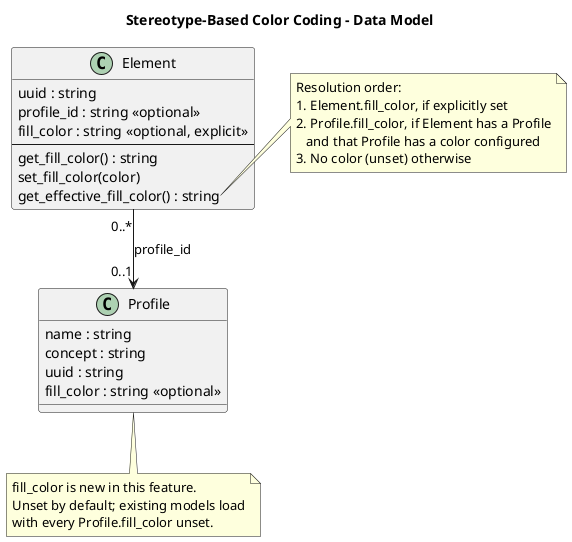
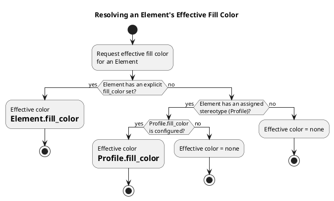
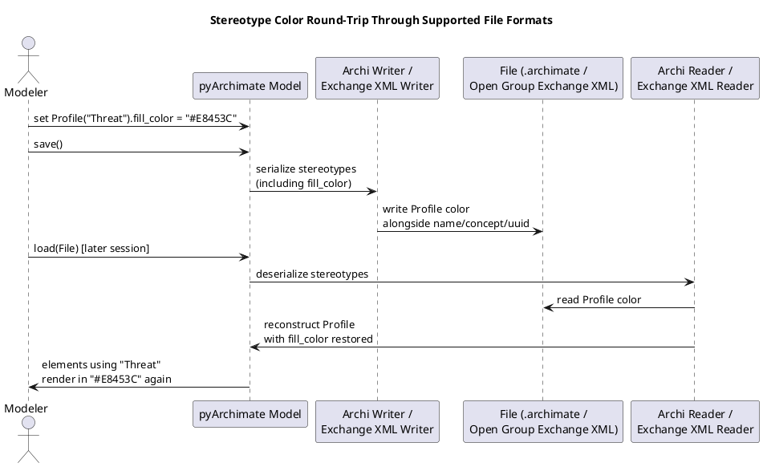

# Feature Specification: Stereotype-Based Color Coding

**Feature Branch**: `017-stereotype-colors`

**Created**: 2026-11-28

**Status**: Draft

**Input**: User description: "Stereotype-based color coding for ArchiMate elements. Allow a user to configure a specific fill color for a given stereotype (Profile), so that any element assigned that stereotype automatically renders with that fill color, unless the element has its own explicit fill color set. Elements only, fill color only, persisted on the Profile and round-tripped through the .archimate and Open Group Exchange XML formats. Inspired by The Open Group whitepaper 'How to Model Enterprise Risk Management and Security with the ArchiMate Language', which stereotypes Motivation elements (e.g. Threat, Risk, Vulnerability, Control Objective, Control Measure, Loss Event, Asset) and distinguishes them visually by color."

## User Scenarios & Testing *(mandatory)*

### User Story 1 - Define a default color per stereotype (Priority: P1)

A modeler defines a set of stereotypes (e.g. Threat, Risk, Control Objective) for a risk-and-security model and wants every element carrying a given stereotype to show up in a consistent color, without manually coloring each element one at a time.

**Why this priority**: This is the core value of the feature — without it, there is no automatic color coding, and users are stuck with the existing per-element-only styling workflow.

**Independent Test**: Can be fully tested by configuring a color on a stereotype, assigning that stereotype to several elements that have no color of their own, and confirming all of them render in the configured color.

**Acceptance Scenarios**:

1. **Given** a stereotype "Threat" with no color configured, **When** the modeler sets its color to a valid value, **Then** every element currently assigned the "Threat" stereotype that has no explicit fill color of its own immediately renders in that color.
2. **Given** a stereotype "Risk" with a configured color, **When** a new element is assigned the "Risk" stereotype, **Then** that element renders in the "Risk" stereotype's color without any further action from the modeler.
3. **Given** a stereotype with a configured color, **When** the modeler clears/removes that color, **Then** elements using that stereotype (with no explicit color of their own) revert to having no fill color.

---

### User Story 2 - Override a stereotyped element's color individually (Priority: P2)

A modeler wants most elements of a stereotype to share the stereotype's color, but needs to highlight one or two specific elements differently (e.g. to flag a particularly severe risk) without changing the color for every other element of that stereotype.

**Why this priority**: Without a clear, reliable override rule, modelers cannot trust the automatic coloring and will avoid using it — this scenario protects the feature's usefulness alongside existing manual styling.

**Independent Test**: Can be fully tested by giving an element its own explicit fill color while it carries a stereotype that has a different configured color, and confirming the element keeps its own color.

**Acceptance Scenarios**:

1. **Given** an element assigned a stereotype with a configured color, **When** the modeler sets an explicit fill color directly on that element, **Then** the element renders using its own explicit color, not the stereotype's color.
2. **Given** an element with its own explicit fill color that is also assigned a stereotype with a different configured color, **When** the modeler later removes the element's explicit color, **Then** the element falls back to rendering in the stereotype's configured color.
3. **Given** an element with no explicit color, **When** its stereotype is changed from one stereotype to another, each with a different configured color, **Then** the element's rendered color updates to match the newly assigned stereotype.

---

### User Story 3 - Stereotype colors survive save and reload (Priority: P3)

A modeler configures stereotype colors, saves the model, closes it, and reopens it later (or shares the file with a colleague, or exchanges it with another ArchiMate tool) — the stereotype colors must still be there.

**Why this priority**: A coloring scheme that disappears on reload is not trustworthy enough to use for ongoing work, but the modeling and rendering behavior (User Stories 1–2) delivers value even before round-trip persistence is verified end-to-end.

**Independent Test**: Can be fully tested by configuring stereotype colors, saving the model to each supported file format, reloading it, and confirming the colors and their effect on element rendering are unchanged.

**Acceptance Scenarios**:

1. **Given** a model with one or more stereotypes that have configured colors, **When** the model is saved to the Archi-native (`.archimate`) file format and reloaded, **Then** each stereotype's configured color is unchanged and still applies to its elements.
2. **Given** a model with one or more stereotypes that have configured colors, **When** the model is saved to the Open Group Exchange XML format and reloaded, **Then** each stereotype's configured color is unchanged and still applies to its elements.
3. **Given** an existing model file created before this feature existed (no stereotype colors present), **When** it is opened, **Then** it loads without error and all stereotypes simply have no configured color, matching prior behavior.

### Edge Cases

- What happens when a stereotype's color is set to an invalid value (not a recognized 6-digit hex code or named color)? The system must reject it with a clear error, the same way it already does for per-element colors.
- What happens when an element has no stereotype assigned at all? It keeps its current behavior — explicit color if set, otherwise no color — unaffected by this feature.
- What happens when a stereotype is deleted while elements still reference it? Those elements lose the stereotype (existing deletion behavior already clears the reference) and therefore lose the stereotype-derived color; an explicit element color, if any, is unaffected.
- What happens when two different stereotypes that apply to the same concept type both have colors configured, and an element's stereotype assignment changes between them? The element's resolved color always reflects whichever single stereotype is currently assigned.
- What happens when a stereotype is shared across many elements and its color is edited? All elements using that stereotype without their own explicit color must reflect the new color the next time color is resolved (read or exported), without needing to touch each element individually.

## Requirements *(mandatory)*

### Functional Requirements

- **FR-001**: System MUST allow a color to be configured on a stereotype (Profile) definition, independent of any element.
- **FR-002**: System MUST accept the same color value formats for a stereotype's color as it already accepts for an individual element's fill color (6-digit hex code, or an English color name, case-insensitive), and MUST reject invalid values with a clear error.
- **FR-003**: System MUST allow a stereotype's configured color to be left unset (no default color) and to be cleared back to unset after being configured.
- **FR-004**: When determining an element's effective (rendered) fill color, the system MUST use the element's own explicit fill color if one has been set, regardless of any stereotype color.
- **FR-005**: When an element has no explicit fill color of its own but is assigned a stereotype that has a configured color, the system MUST use that stereotype's color as the element's effective fill color.
- **FR-006**: When an element has no explicit fill color and either has no stereotype assigned or its assigned stereotype has no configured color, the system MUST behave exactly as it does today (no fill color applied).
- **FR-007**: Changing a stereotype's configured color MUST be reflected in the effective color of every element using that stereotype (without an explicit color of its own) the next time that element's color is read or the view is exported — without requiring any change to the elements themselves.
- **FR-008**: Reassigning an element to a different stereotype MUST cause its effective color (when it has no explicit color) to be resolved from the newly assigned stereotype.
- **FR-009**: A stereotype's configured color MUST be saved as part of the stereotype definition and MUST be restored correctly after saving to and reloading from the Archi-native (`.archimate`) file format.
- **FR-010**: A stereotype's configured color MUST be saved as part of the stereotype definition and MUST be restored correctly after saving to and reloading from the Open Group Exchange XML file format.
- **FR-011**: Rendering an element in an exported view (e.g. SVG export) MUST use the element's effective fill color as resolved per FR-004–FR-006, not the element's stored explicit color alone.
- **FR-012**: This feature applies only to Elements; Relationships are out of scope and are unaffected by stereotype color configuration.
- **FR-013**: This feature covers fill color only; a stereotype's line color, line width, and transparency are out of scope and remain configurable only per individual element, as today.
- **FR-014**: Loading a model file created before this feature existed MUST succeed without error, with every stereotype's color treated as unset.

### Key Entities

- **Stereotype (Profile)**: An existing named specialization of a specific ArchiMate concept type (e.g. "Threat" specializing Driver). Gains one new attribute: an optional default fill color that applies to elements carrying this stereotype.
- **Element**: An existing ArchiMate model element that may carry zero or one stereotype and may have its own explicit fill color. Its effective (rendered) fill color is now resolved from its own explicit color first, falling back to its assigned stereotype's color, falling back to no color.

## Diagrams

### Stereotype / Element color model

### Effective color resolution logic

### Stereotype color persistence round-trip

## Success Criteria *(mandatory)*

### Measurable Outcomes

- **SC-001**: A modeler can apply a consistent color to every element of a given stereotype by configuring the color once on the stereotype, instead of setting it on each element individually.
- **SC-002**: 100% of elements that have a configured stereotype color and no explicit element-level color render with that stereotype's color in every exported view.
- **SC-003**: 100% of configured stereotype colors are preserved, unchanged, after a full save/reload round trip in both the Archi-native (`.archimate`) and Open Group Exchange XML formats.
- **SC-004**: 0% of elements with an explicitly set fill color have that color silently replaced by a stereotype color, in any scenario covered by this feature.
- **SC-005**: Existing model files created before this feature existed continue to load and render exactly as before, with no visual change, until a stereotype color is explicitly configured.

## Assumptions

- Stereotype colors use the same accepted color value formats already used for per-element fill colors (6-digit hex code, or an English color name, case-insensitive).
- Relationships are out of scope for this feature; stereotype-based coloring of relationships may be considered as a future enhancement.
- Only fill color is in scope; a stereotype's line color, line width, and transparency remain per-element settings only, unaffected by this feature.
- The risk-and-security stereotype examples referenced in this specification (Threat, Risk, Vulnerability, Control Objective, Control Measure, Loss Event, Asset), drawn from The Open Group's ERM/Security whitepaper, are illustrative only — the feature itself must work generically for any user-defined stereotype name, not just these.
- A model file saved before this feature existed has no stereotype colors recorded; loading it must not fail and must not invent default colors for existing stereotypes.
